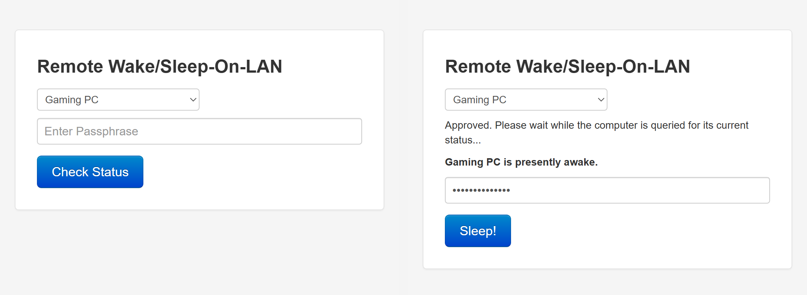
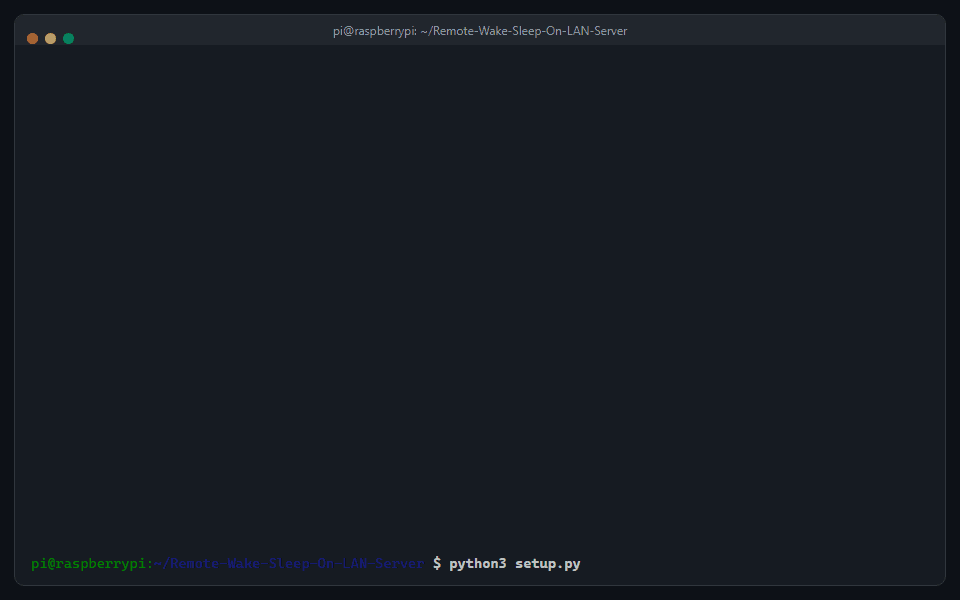

REMOTE WAKE/SLEEP-ON-LAN SERVER *(RWSOLS)*
==========================================
The Remote Wake/Sleep-on-LAN Server (RWSOLS) is a simple webapp that runs on your Raspberry Pi to turn it into a remotely accessible Wake/Sleep-On-LAN Server. This is very useful when you have a high-powered machine that you don't want to keep on all the time, but that you want to keep remotely accessible for Remote Desktop, SSH, FTP, etc. Wake-On-LAN packets cannot be forwarded through a router, so to wake up a remote machine behind a router, you need to have something on its local network to wake it up. That's where RWSOLS comes in. RWSOLS can control an unlimited number of remote machines on its local network, and is capable of waking them up (any OS) or putting them to sleep (only Windows remote machines). It can be configured to use signed or unsigned SSL encryption or it can be run over traditional HTTP.

What you get
------------
- **Wake and sleep from anywhere.** A small web page, served by your Pi, that wakes any computer on your network and puts Windows computers to sleep. It works well on a phone.
- **Guided setup.** One script installs everything and asks its questions one decision at a time. No config file to edit by hand.
- **Three ways to reach it**, chosen during setup and changeable later:
  - **Home only.** Nothing is exposed to the internet.
  - **Cloudflare Tunnel.** Reach it from outside with no open router ports and your home IP address hidden.
  - **Port forwarding.** The original method, with dynamic DNS and a Let's Encrypt certificate.
- **Optional extras for your home network**, set up by the same script: dynamic DNS for your domain (ddclient), and a trusted HTTPS certificate for the Pi's name on your LAN.

Setup
-----
On a Raspberry Pi running Raspberry Pi OS:

    git clone https://github.com/sciguy14/Remote-Wake-Sleep-On-LAN-Server.git && cd Remote-Wake-Sleep-On-LAN-Server
    python3 setup.py

The script shows a checklist of seven sections with what is done and what is left, and goes through them in order. You can stop at any time and it continues where you left off. Run it again later to change one section without answering everything again, or to start over.

It checks what you type as you go. It looks up your domain to see whether Cloudflare Tunnel is possible before offering it, checks a Cloudflare API token before using it, and asks for each computer's name, MAC address and IP address one at a time.

Full instructions, including what to set up on your computers and router first: **[Installation (v4)](https://github.com/sciguy14/Remote-Wake-Sleep-On-LAN-Server/wiki/Installation-(v4))**. That page also covers [upgrading from v3](https://github.com/sciguy14/Remote-Wake-Sleep-On-LAN-Server/wiki/Installation-(v4)#upgrading-from-v3).

Keeping it secure
-----------------
| Option | What it does |
|---|---|
| Passphrase | Required for every action, including checking a computer's status. Stored only as a hash. |
| Login throttling | Five wrong passphrases from one address lock that address out for 15 minutes. On by default. |
| [Cloudflare Tunnel](https://github.com/sciguy14/Remote-Wake-Sleep-On-LAN-Server/wiki/Remote-Access-with-Cloudflare-Tunnel) | The Pi connects out to Cloudflare. No ports are opened on your router and your home IP address is not published. |
| [Cloudflare Access](https://github.com/sciguy14/Remote-Wake-Sleep-On-LAN-Server/wiki/Adding-Cloudflare-Access-(optional)) | An extra login at Cloudflare, before a visitor reaches your Pi at all. RWSOLS verifies it too. Optional, with a tunnel. |
| Hostname allowlist | The Pi answers only to the names you list, which protects against DNS rebinding. Optional. |
| HTTPS | A trusted certificate through the tunnel, Let's Encrypt with port forwarding, and on your LAN either a trusted certificate (DNS challenge) or a self-signed one. |
| Automatic security updates | The script offers to turn on unattended security updates for the operating system. |

API tokens that setup needs only once are never written to disk. The ones that have to stay on the Pi are stored in files only root can read. The **[Security](https://github.com/sciguy14/Remote-Wake-Sleep-On-LAN-Server/wiki/Security)** page explains what each choice exposes and how to recover if you lock yourself out.

Documentation
-------------
Everything is in the [wiki](https://github.com/sciguy14/Remote-Wake-Sleep-On-LAN-Server/wiki):

- [Installation (v4)](https://github.com/sciguy14/Remote-Wake-Sleep-On-LAN-Server/wiki/Installation-(v4)): the full walkthrough, changing things later, and upgrading from v3.
- [Remote Access with Cloudflare Tunnel](https://github.com/sciguy14/Remote-Wake-Sleep-On-LAN-Server/wiki/Remote-Access-with-Cloudflare-Tunnel): how the tunnel works, the API token, certificates, and moving over from port forwarding.
- [Adding Cloudflare Access](https://github.com/sciguy14/Remote-Wake-Sleep-On-LAN-Server/wiki/Adding-Cloudflare-Access-(optional)).
- [Security](https://github.com/sciguy14/Remote-Wake-Sleep-On-LAN-Server/wiki/Security) and the [Configuration Reference](https://github.com/sciguy14/Remote-Wake-Sleep-On-LAN-Server/wiki/Configuration-Reference) for every `config.php` setting.
- [How it Works](https://github.com/sciguy14/Remote-Wake-Sleep-On-LAN-Server/wiki/How-it-Works), [Terminology](https://github.com/sciguy14/Remote-Wake-Sleep-On-LAN-Server/wiki/Terminology), and [Notes and FAQs](https://github.com/sciguy14/Remote-Wake-Sleep-On-LAN-Server/wiki/Notes-and-FAQs).

What changed in each version is in the [changelog](CHANGELOG.md). For background, see [my blog post about RWSOLS](https://www.jeremyblum.com/2013/07/14/rpi-wol-server/).

If you're having problems, check the [FAQ](https://github.com/sciguy14/Remote-Wake-Sleep-On-LAN-Server/wiki/Notes-and-FAQs) first, or [the comments](https://www.jeremyblum.com/2013/07/14/rpi-wol-server/#comments) on my blog. If you still can't get it to work, please [create a GitHub issue](https://github.com/sciguy14/Remote-Wake-Sleep-On-LAN-Server/issues) with specific details.

Running the tests
-----------------
The PHP and Python tests need no Apache, root or network access. From the repository root:

    php tests/php/run.php
    python -m unittest discover -s tests/python -v

See `tests/php/README.md` and `tests/python/README.md` for details.

License
-------
Copyright 2026 [Jeremy Blum](https://www.jeremyblum.com), [Blum Idea Labs, LLC.](https://www.blumidealabs.com)  
This project is licensed under the GPLv3 license (see LICENSE.md for details).  
Please share improvements or remixes with the community, and attribute me (Jeremy Blum, <https://www.jeremyblum.com>) when reusing portions of my code.  
  
Other contributors to this work include:
- Felix Ryan (https://www.felixrr.pro)
